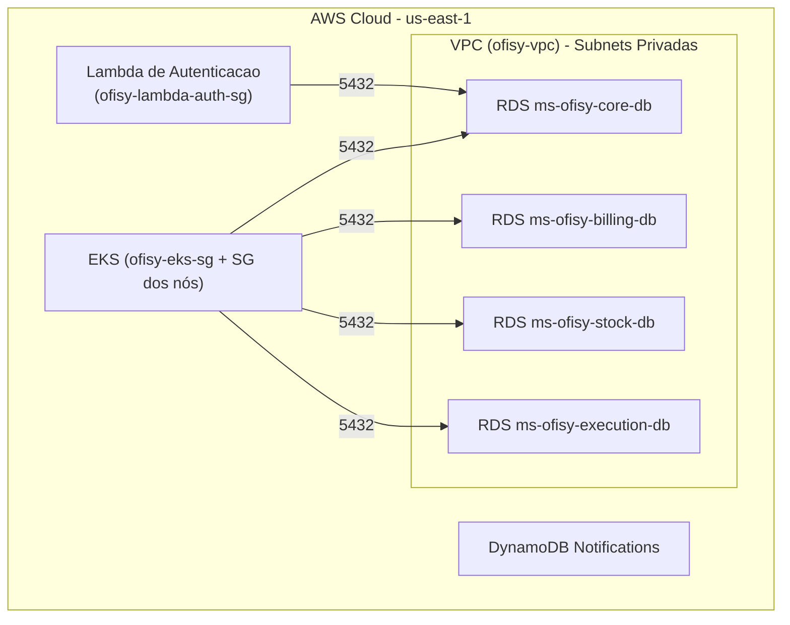
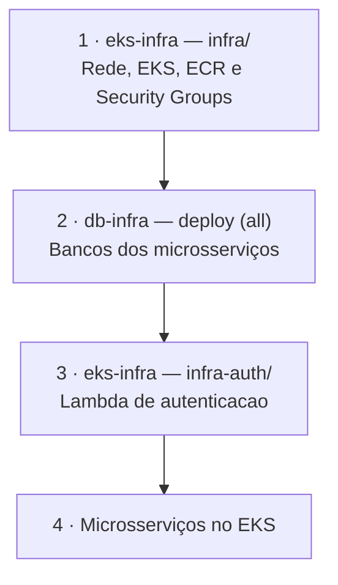

# Ofisy - Infraestrutura dos Bancos de Dados

Este repositório provisiona via **Terraform** os bancos de dados dos microsserviços da plataforma **Ofisy**, conforme os requisitos do **Tech Challenge (SOAT / FIAP)**. Cada microsserviço tem o seu próprio banco, com state e ciclo de vida independentes.

O ambiente roda no **AWS Academy** e é efêmero: os bancos são criados para a apresentação e destruídos ao fim da sessão. Por isso não há backups automáticos nem proteções contra exclusão.

---

## Bancos Provisionados

| Diretório | Microsserviço | Recurso | Banco / Tabela | Chave do state |
|---|---|---|---|---|
| `core/` | ms-ofisy-core | RDS `ms-ofisy-core-db` | `ms_ofisy_core_db` | `databases/core/terraform.tfstate` |
| `billing/` | ms-ofisy-billing | RDS `ms-ofisy-billing-db` | `ms_ofisy_billing_db` | `databases/billing/terraform.tfstate` |
| `stock/` | ms-ofisy-stock | RDS `ms-ofisy-stock-db` | `ms_ofisy_stock_db` | `databases/stock/terraform.tfstate` |
| `execution/` | ms-ofisy-execution | RDS `ms-ofisy-execution-db` | `ms_ofisy_execution_db` | `databases/execution/terraform.tfstate` |
| `notification/` | ms-ofisy-notification | DynamoDB | `Notifications` | `databases/notification/terraform.tfstate` |

Os RDS são PostgreSQL 15, `db.t3.micro`, em subnets privadas, com usuário `admin_db` e senha vinda da secret `DB_PASSWORD`. Todos usam o módulo `modules/postgresql/`.

---

## Estrutura do Repositório

```
├── .github/workflows/
│   ├── deploy.yml          # Provisiona um banco ou todos (input "service")
│   ├── destroy.yml         # Destrói um banco ou todos (input "service")
│   └── validate.yml        # fmt + validate em PRs, sem acesso à AWS
├── modules/postgresql/     # RDS, DB Subnet Group, Security Group e data sources de rede
├── core/  billing/  stock/  execution/   # Uma raiz por microsserviço, chamando o módulo
└── notification/           # Tabela DynamoDB do ms-ofisy-notification
```

---

## Arquitetura



Cada RDS tem o próprio Security Group (`ms-ofisy-<service>-db-sg`), liberando a porta 5432 para o EKS. Só o core libera também a Lambda de autenticação. A VPC, as subnets e os Security Groups de origem são criados pela [infraestrutura base](https://github.com/15SOAT-FIAP/techchallenge-ofisy-eks-infra) e localizados aqui por tag.

A tabela `Notifications` usa `PAY_PER_REQUEST`, chave `id` e dois índices: `TypeIndex` (`type` + `createdAt`) e `ReferenceIdIndex` (`referenceId`).

---

## Ordem de Execução entre os Repositórios

Os RDS dependem da rede e do EKS. A Lambda de autenticação depende do banco do core.



Para **destruir**, siga o caminho inverso: a Lambda precisa ser destruída antes do banco do core.

---

## Pipeline (GitHub Actions)

- **Deploy Bancos de Dados**: execução manual. Escolha `all` para subir todos em paralelo ou um serviço específico.
- **Destruir Bancos de Dados**: execução manual, com o mesmo input.
- **Validar Terraform**: roda em PRs e na `master` (`fmt` + `validate` em cada raiz, sem AWS).

### Secrets Necessárias

Definidas como **Organization Secrets** na org `15SOAT-FIAP`:

- `AWS_ACCESS_KEY_ID`, `AWS_SECRET_ACCESS_KEY`, `AWS_SESSION_TOKEN`: credenciais da sessão do AWS Academy.
- `AWS_ACCOUNT_ID`: ID da conta, usado no nome do bucket de state (`ofisy-tfstate-<account_id>`).
- `DB_PASSWORD`: senha do usuário `admin_db` dos RDS (mínimo 8 caracteres).

---

## Execução Local

```bash
cd stock
export TF_VAR_db_password="<SENHA>"
terraform init \
  -backend-config="bucket=ofisy-tfstate-<AWS_ACCOUNT_ID>" \
  -backend-config="key=databases/stock/terraform.tfstate" \
  -backend-config="region=us-east-1"
terraform plan
terraform apply
```

---

## Repositórios Relacionados

- **Aplicação Principal:** [techchallenge-ofisy](https://github.com/15SOAT-FIAP/techchallenge-ofisy)
- **Infraestrutura Kubernetes (EKS):** [techchallenge-ofisy-eks-infra](https://github.com/15SOAT-FIAP/techchallenge-ofisy-eks-infra)
